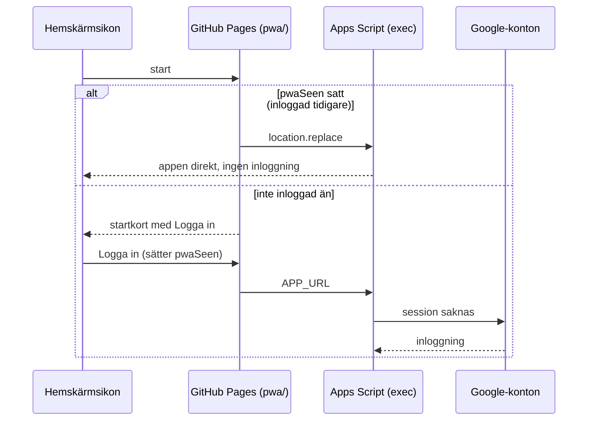
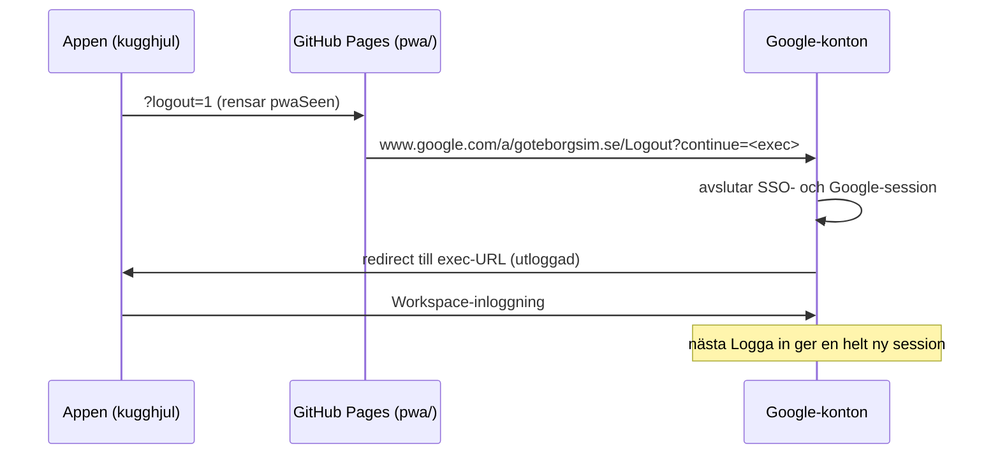

# Träningsnärvaro (training presence app)

Enkel och snabb mobilapplikation för träningsnärvaro.

## Översikt
- **Source of Truth:** Google Sheet är master för all närvarodata och medlemshantering.
- **Miljö:** Körs som en standalone webbapplikation via Google Apps Script `HtmlService`.
- **Kommunikation:** Backendanrop sker uteslutande via `google.script.run`.
- **Aktuell status:** Steg 1, Steg 2, Steg 3 och Steg 4 implementerade.
  - Steg 1: Mobilanpassad snabb närvarovy (Idag / Igår / 2 dagar sedan, val av träningsgrupp, touchvänliga rader, diskret kontrollräkning).
  - Steg 2: Diskret kugghjul som navigerar till administration.
  - Steg 3: `saveAttendance(date, location, attendance)` för att spara närvaro och skapa saknade träningskolumner.
  - Steg 4: `deleteTrainingColumn(date, location)` i administrationen för att fysiskt radera felaktigt skapade träningskolumner med `deleteColumn()`, skyddat av `LockService` och efterföljande verifiering.
- **Filer:**
  - `Index.html`: Fristående Apps Script-fil med HTML, CSS och JavaScript i ett, redo att klistras in i Google Apps Script.
  - `Kod.gs`: Google Apps Script backendfunktioner inklusive `deleteTrainingColumn()`.
- **PWA:** `pwa/` innehåller en statisk wrapper (GitHub Pages) för hemskärmsikon på iPhone/Android. Ikonfiler i `icons/`.

## Start och utloggning

`pwa/index.html` är startpunkten för hemskärmsikonen. Wrappern visar ett startkort
med **Logga in** tills användaren har loggat in en gång, och går därefter direkt
till appen vid varje start.

Vid utloggning kan Google inte skicka tillbaka webbläsaren till GitHub-sidan:
`accounts.google.com/Logout` svarar **HTTP 400** för alla `continue`-URL:er som inte
ligger på en Google-domän. Därför avslutas sessionen via Workspace-utloggningen, som
i sin tur landar på appens egen inloggningssida.

Startflaggan `pwaSeen` sätts **endast** när användaren klickar på Logga in, aldrig
bara för att startkortet visas. iOS ger en hemskärmsapp en egen lagringsyta, så en
flagga satt i Safari skulle annars göra att första trycket på en ny ikon hamnade på
Googles inloggningssida.

